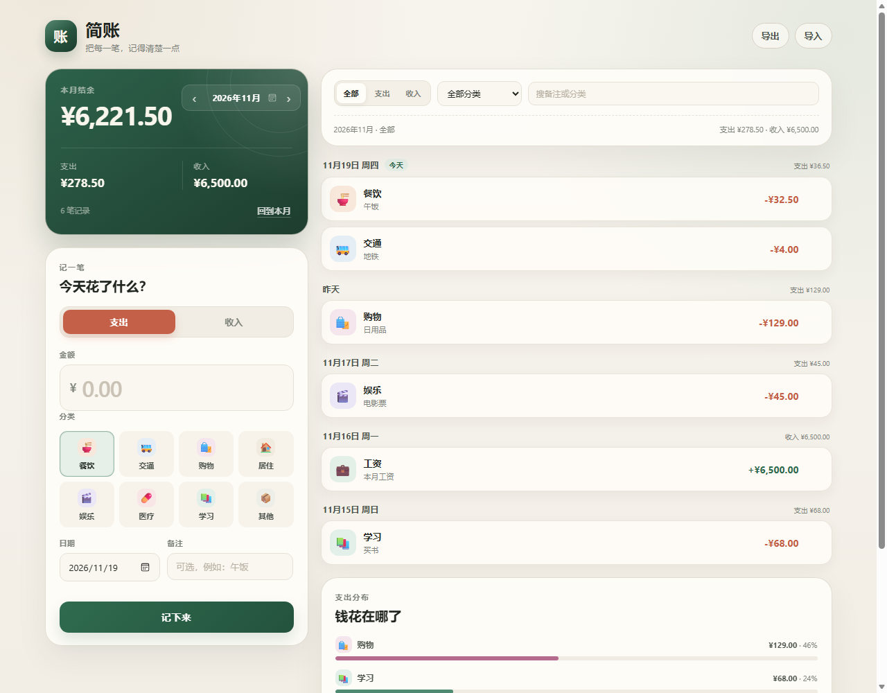
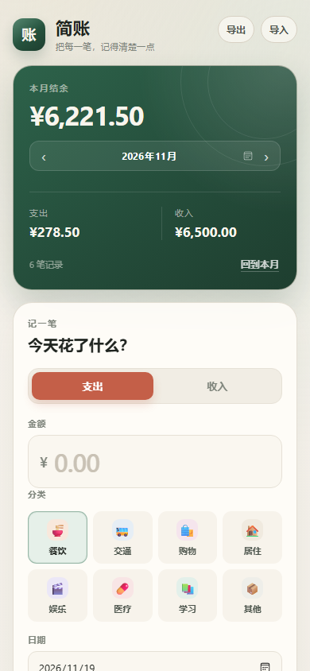
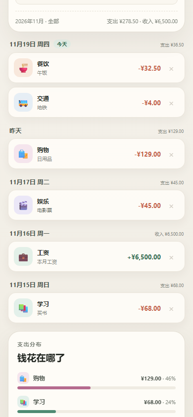

# 简账

一个只做记账的本地小 App：记收入、记支出、看月度结余，数据只存在自己的设备里，不需要服务器。

| 桌面端 | 手机端 |
| --- | --- |
|  |  |

手机端账目列表：



## 功能

- 支出 / 收入切换
- 金额、分类、日期、备注
- 编辑、删除
- 按月查看：上个月 / 下个月 / 回到本月
- 按类型、分类、关键词筛选
- 本月支出、收入、结余
- 支出分类占比
- 本地保存，刷新 / 重启后还在
- JSON 备份导出 / 导入
- 空状态可载入示例数据
- 手机 / 桌面自适应

这一版**只做记账**，还没有天气、登录、多设备同步、预算、图表报表。

## 直接下载 APK

- [jianzhang-1.0.apk](dist/jianzhang-1.0.apk)
- 包名：`com.wuzhongdui.ledger`
- 版本：1.0
- 大小：约 57 KB
- 最低系统：Android 10（API 29）
- 不需要服务器，断网可用

APK 是 **debug 签名**，自己用、发班里安装没问题；以后升级要保留 `ledger-android/keystore/debug.keystore`，否则不能覆盖安装。要上架或正式发布，需要换 release 签名。

## 网页版运行

```powershell
cd ledger
python -m http.server 8091 --bind 127.0.0.1
```

打开 `http://127.0.0.1:8091/`。

也可以直接双击 `ledger/index.html` 快速看，但长期使用建议用上面的本地静态服务。

## 构建 APK

需要：

- JDK（`javac`、`keytool` 在 PATH 中）
- Android SDK：`%USERPROFILE%\android-sdk`
  - `build-tools`（脚本自动选最新）
  - `platforms/android-34`（或更新）
- Python（用于把 `classes.dex` 写进 APK）

```powershell
cd ledger-android
powershell -ExecutionPolicy Bypass -File .\build-apk.ps1 -VersionName "1.0" -VersionCode 1
```

输出：

```text
ledger-android/dist/jianzhang-1.0.apk
```

更详细的 Android 说明见 [ledger-android/README.md](ledger-android/README.md)。

## 数据说明

- 网页版：数据在浏览器的 `localStorage`，key 为 `jianzhang.entries.v1`。
- APK：数据在 App 自己的 WebView 存储里，和手机浏览器不互通。
- 「导出」会生成 JSON 备份；APK 版会通过原生桥保存到手机「下载」目录。
- 卸载 App、清除 App 数据、清理浏览器数据前，先导出备份。

## 目录结构

```text
.
├─ ledger/                网页版（纯 HTML / CSS / JS，零依赖）
│  ├─ index.html
│  ├─ style.css
│  ├─ app.js
│  └─ icon.svg
├─ ledger-android/        Android WebView 壳
│  ├─ AndroidManifest.xml
│  ├─ build-apk.ps1
│  ├─ java/com/wuzhongdui/ledger/MainActivity.java
│  └─ res/
├─ dist/
│  └─ jianzhang-1.0.apk
└─ screenshots/
```

## 技术说明

- 网页端零框架、零外部依赖，直接打开就能用。
- Android 端用原生 `WebView`，通过自定义资源拦截器从 `https://appassets.androidplatform.net/ledger/` 加载 APK 内置资源，保证 `localStorage` 有稳定 origin。
- 导出 JSON 在 APK 内走 `@JavascriptInterface` 原生桥，保存到 `MediaStore.Downloads`。
- 所有用户输入都用 `textContent` 渲染，不用 `innerHTML` 拼接账目内容。

## 后续

- 天气 API（Open-Meteo 不需要 key；和风天气需要 key + Serverless 代理）
- 预算、图表报表
- 多设备同步
- release 签名 / 上架
